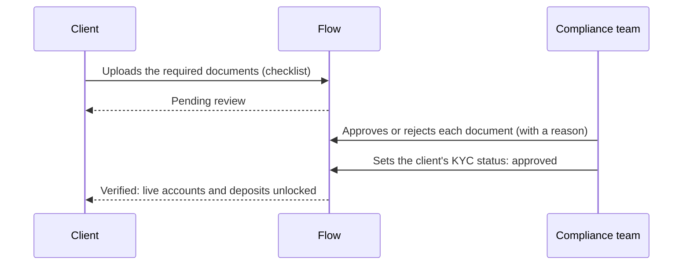
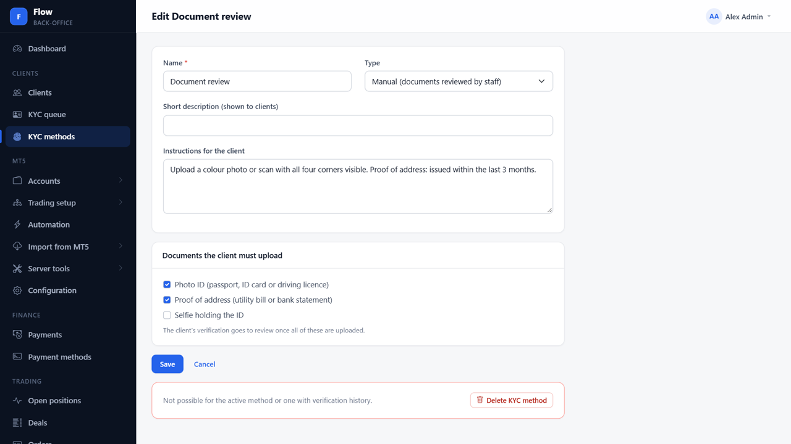
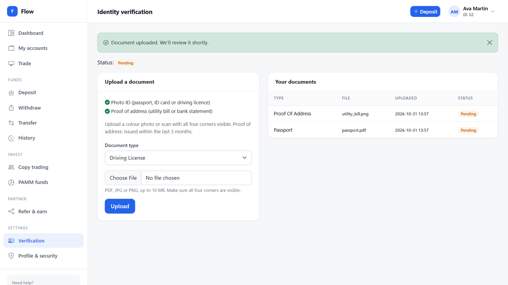
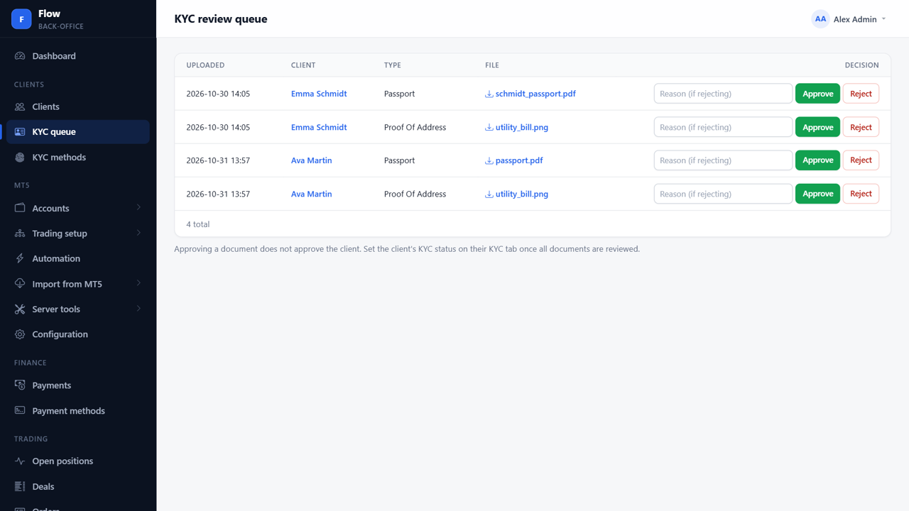
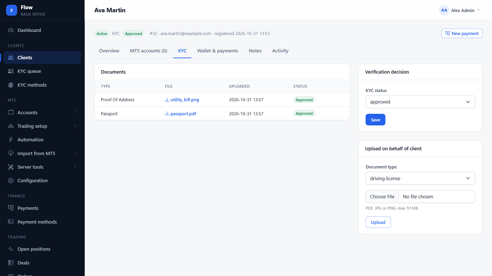
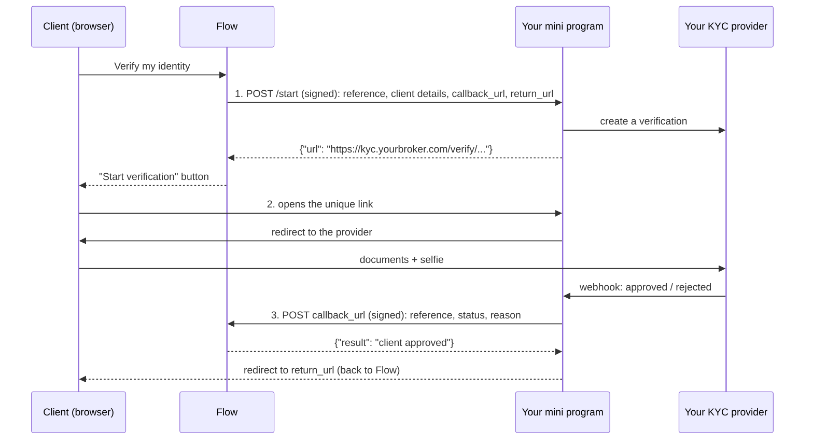
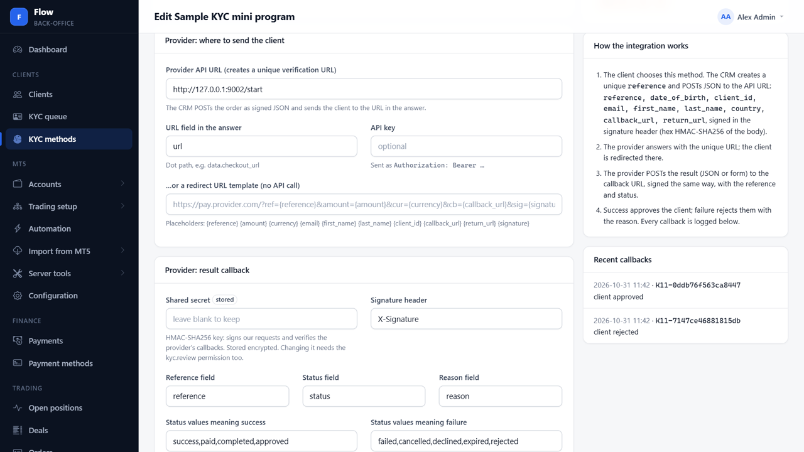
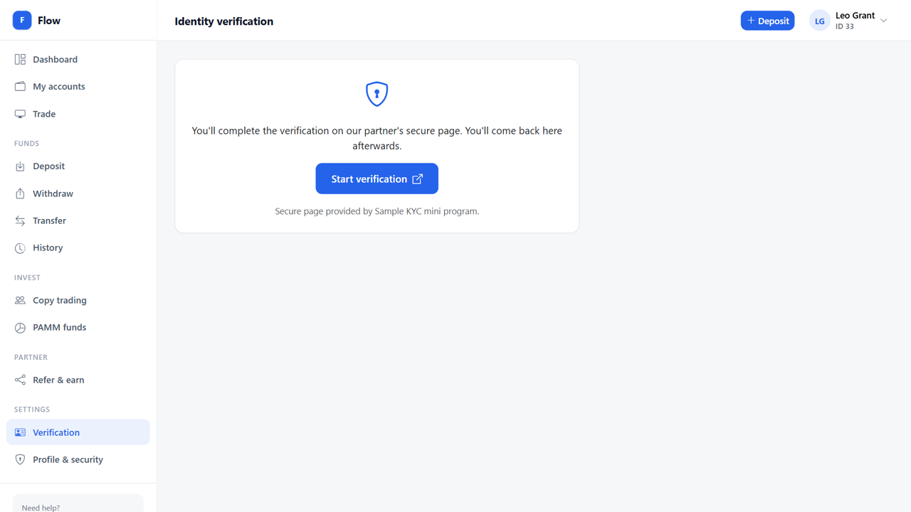
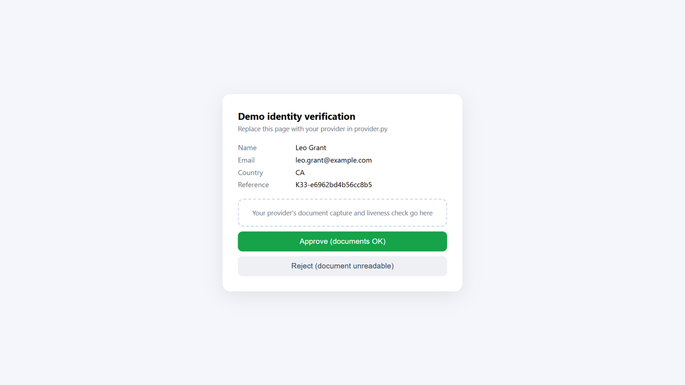
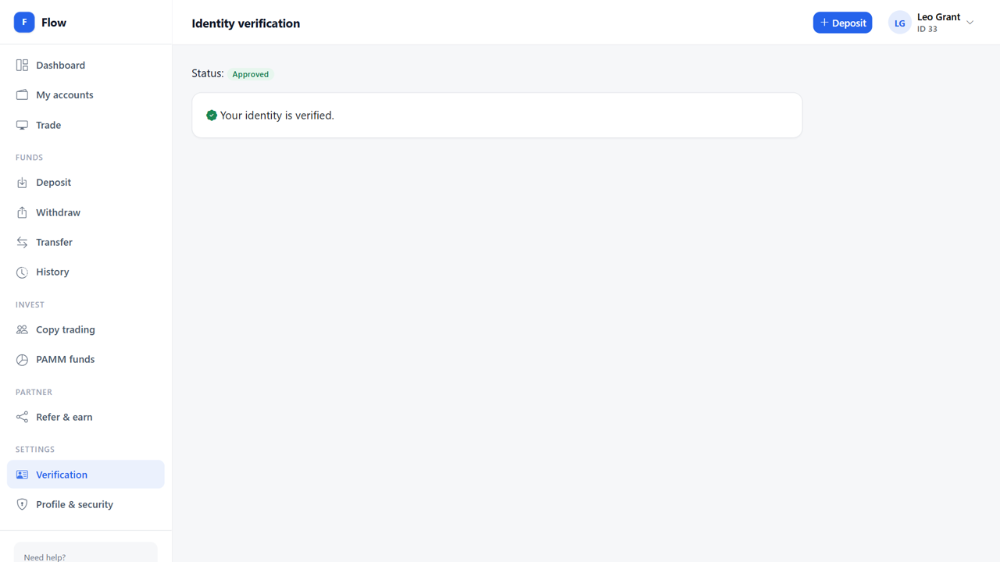

# KYC methods

Flow verifies clients through **KYC methods**, configured under **Clients → KYC methods**. You can set up
several, but **exactly one is active** and used for every client. There are two kinds:

| | Manual | Custom |
|---|---|---|
| **For** | Your own compliance team | Any verification provider (Sumsub, Onfido, Veriff, a local e-KYC service...) |
| **The client** | Uploads the documents you require | Clicks *Verify my identity* and completes the checks on the provider's page |
| **Who decides** | Your staff, document by document | Your provider, through your **mini program** |
| **Code needed** | None | A small mini program: sample in [`custom/`](custom/) |

**Video (2½ minutes):** [kyc-methods.mp4](kyc-methods.mp4), both flows from start to finish.

This folder:

- [`manual/`](manual/): screenshots of the manual flow.
- [`custom/`](custom/): the sample mini program (`mini_program.py`, `provider.py`) and screenshots of the custom flow.

With the default settings (`LIVE_REQUIRES_KYC=true`), a client must be verified before opening live accounts,
depositing or withdrawing.

## Manual methods



1. **Set up the method.** Clients → KYC methods → New, type **Manual**: tick the documents the client must
   provide (photo ID, proof of address, selfie holding the ID) and write instructions. Save, then
   **Activate** it.
2. **The client uploads.** The client area's *Verification* page shows a checklist of what's required. Each
   upload ticks an item off; the client's status becomes **pending**.
3. **Compliance reviews.** Clients → KYC queue lists every document waiting. **Approve** or **Reject**
   (with a reason the client sees) each one. Staff can also upload on the client's behalf.
4. **Staff decide.** On the client's page, *KYC* tab, set the status to **approved** (or rejected). Approving
   documents alone doesn't verify the client: the decision is always explicit.

| 1. The method | 2. The client uploads |
|---|---|
|  |  |
| **3. The KYC queue** | **4. The decision** |
|  |  |

## Custom methods

Every broker verifies clients differently: Sumsub, Onfido, Veriff, a local e-KYC service, or your own
compliance team. Instead of building them all in, Flow lets you plug in **any** verification provider by
writing a small **mini program** that sits between Flow and your provider.

The sample mini program is in [`custom/`](custom/): Python, standard library only, about 200 lines.

### How it works



1. **Flow asks your mini program for a unique link.** When a client starts verification, Flow sends a
   signed `POST` to the method's *Provider API URL*. The client's status becomes *pending*.
2. **The client goes to that link.** Flow shows a *Start verification* button that opens it. Your mini
   program and your provider handle documents, liveness checks and review.
3. **Your mini program reports the result.** It sends a signed `POST` to the `callback_url` it received in
   step 1, then sends the client back to the `return_url`. `approved` verifies the client in Flow;
   `rejected` lets them try again and shows them the reason.


| 1. The method | 2. Flow's start button |
|---|---|
|  |  |
| **3. The mini program** | **4. Verified automatically** |
|  |  |

### Try it in 5 minutes

1. Start the Flow demo (`run-demo.ps1`), or use your own Flow.
2. Run the sample:

   ```powershell
   cd docs/kyc/custom
   $env:FLOW_SECRET = "choose-a-long-random-secret"
   $env:FLOW_URL = "http://127.0.0.1:8000"
   python mini_program.py
   ```

3. In Flow's back office: **Clients → KYC methods → New**.
   - Type: **Custom**
   - Provider API URL: `http://127.0.0.1:9002/start`
   - Shared secret: the same value as `FLOW_SECRET`
   - Save, then **Activate** it. Only one KYC method is active at a time.
4. Log in to the client area as a client who isn't verified yet (in the demo: `noah.kim@example.com` /
   `Client-Pass1`). Open **Verification**, start it, and choose **Approve** or **Reject** on the demo page.

### Settings of the sample

| Variable | Meaning |
|---|---|
| `FLOW_SECRET` | The method's **Shared secret** in Flow. Required. Signs both directions. |
| `FLOW_API_KEY` | The method's **API key** in Flow, if you set one. Flow then sends `Authorization: Bearer <key>`. |
| `FLOW_URL` | Your Flow address. The mini program only accepts `callback_url`s on it. |
| `PUBLIC_URL` | The mini program's address as clients reach it, e.g. `https://kyc.yourbroker.com`. |
| `PORT` | Default `9002`. |

### The contract

You can write the mini program in any language. It only has to follow these rules.

#### Signatures

Every request in both directions carries a signature header (default `X-Signature`):

```
X-Signature: hex( HMAC-SHA256( key = shared secret, message = raw request body ) )
```

Compute it over the **exact bytes** you send or receive, before any JSON parsing. A `sha256=` prefix is
accepted. Compare signatures in constant time.

```js
// Node.js
const sig = require("crypto").createHmac("sha256", secret).update(rawBody).digest("hex");
```

```php
// PHP
$sig = hash_hmac('sha256', $rawBody, $secret);
```

#### 1. Flow → mini program: create a verification

`POST <Provider API URL>`, `Content-Type: application/json`, signed. Optional `Authorization: Bearer <API key>`.

| Field | Example | Notes |
|---|---|---|
| `reference` | `K11-0ddb76f563ca8447` | Flow's id for this verification. Send it back in the callback. |
| `client_id` | `11` | |
| `email`, `first_name`, `last_name` | | |
| `country` | `KR` | ISO code, may be empty. |
| `date_of_birth` | `1990-04-21` | May be empty. |
| `callback_url` | `https://portal.yourbroker.com/callbacks/kyc/<token>` | Where to report the result. |
| `return_url` | `https://portal.yourbroker.com/portal/verification` | Where to send the client afterwards. |

**Answer** within 15 seconds with HTTP 200 and JSON containing the client's link:

```json
{"url": "https://kyc.yourbroker.com/verify/87knF2XCs7NBs892"}
```

If the link sits elsewhere in your answer, set **URL field in the answer** to its dot path
(e.g. `data.verification_url`). Any non-2xx answer, or no URL, shows the client *"not available right now"*.
Flow never follows redirects and, in production, only calls public `https://` addresses.

#### 2. The client

Flow shows a *Start verification* button that opens your link. Once they've finished, send them to
`return_url`, where Flow shows their status. Reviews can take hours: the callback may arrive long after the
client has returned, and that's fine.

#### 3. Mini program → Flow: report the result

`POST <callback_url>`, JSON (or form-encoded), signed:

```json
{"reference": "K11-0ddb76f563ca8447", "status": "approved", "reason": ""}
```

| Field | Meaning |
|---|---|
| `reference` | From step 1. |
| `status` | `approved` / `success` / `completed`: verified. `rejected` / `declined` / `failed` / `cancelled` / `expired`: not verified (shows `reason` to the client). Anything else, e.g. `pending`: noted, still waiting. |
| `reason` | Shown to the client when rejected, e.g. "The document photo was not readable". |

All field names and status values can be changed on the method in Flow (*Reference field*, *Status field*,
*Reason field*, *Status values meaning success / failure*), so you can even forward a provider's own
callback unchanged.

**Flow's answers:**

| HTTP | Body `result` | What to do |
|---|---|---|
| 200 | `client approved`, `client rejected`, `noted, still pending` | Done. |
| 200 | `ignored: session already approved`, `ignored: client already approved` | Done. Repeats and late results are safe. |
| 401 | `invalid signature` | Wrong secret, or the body changed after signing. |
| 404 | `unknown reference ...` / `unknown callback URL` | Wrong `reference`, or the method's callback URL was replaced. |

On a network error or a 5xx, **retry** (for example after 1, 5 and 30 minutes). Every callback, accepted or
not, is listed under **Recent callbacks** on the method's page in Flow, with its result.

#### Safety built into Flow

- A verification is decided once; repeats are ignored. If staff approved or rejected the client meanwhile,
  the callback is ignored too.
- A custom method approves clients by itself. Setting its secret or activating it needs the `kyc.review`
  permission and is audited.
- Staff can still review, approve or reject any client manually.

### Plug in your real provider

Only [`custom/provider.py`](custom/provider.py) changes. `mini_program.py` already handles Flow.

- `create_verification(session, public_url)`: create the applicant or verification at your provider and
  return its URL. Give the provider `session["id"]` as your external id, `{public_url}/return/{id}` as the
  redirect URL and `{public_url}/provider/webhook` as the webhook URL.
- `parse_webhook(headers, raw)`: **verify the provider's own signature**, then return
  `(session id, status, reason)` with status `approved`, `rejected` or `pending`.
- Delete the demo page functions when you no longer need them.

Decide on the provider's **server-to-server webhook**, never on the client's browser coming back.

### Going live

- [ ] Serve the mini program over **https** behind your reverse proxy, e.g. `https://kyc.yourbroker.com`.
- [ ] Use a long random shared secret (at least 32 characters), kept out of source control.
- [ ] Set `FLOW_URL` to your real Flow address.
- [ ] Verify your provider's webhook signature in `parse_webhook`.
- [ ] Replace `sessions.json` with a database if you run more than one instance.
- [ ] Retry callbacks that fail with a network error or a 5xx.
- [ ] Verify a test client end to end (approve and reject), then check the client's page and the method's **Recent callbacks**.
