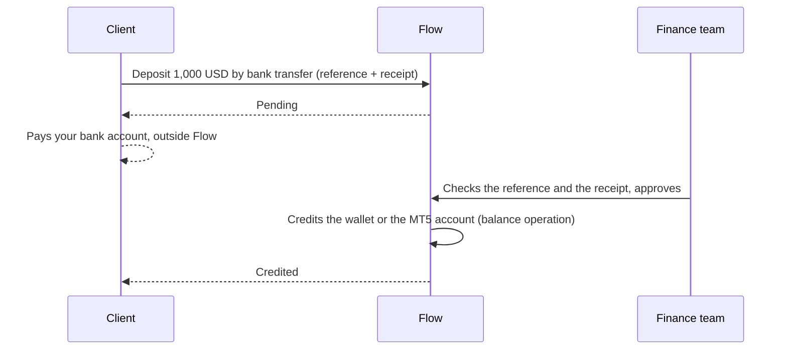
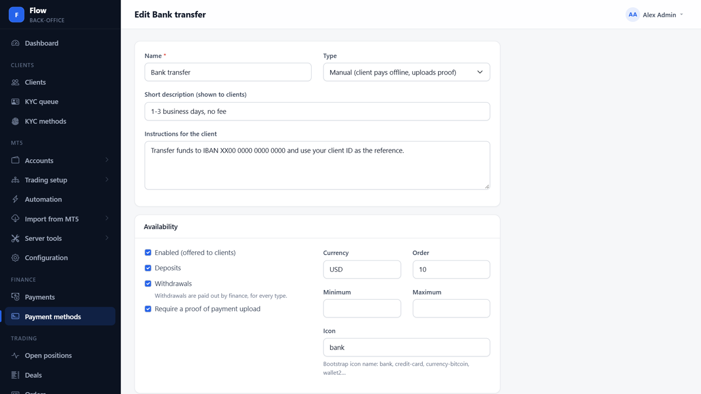
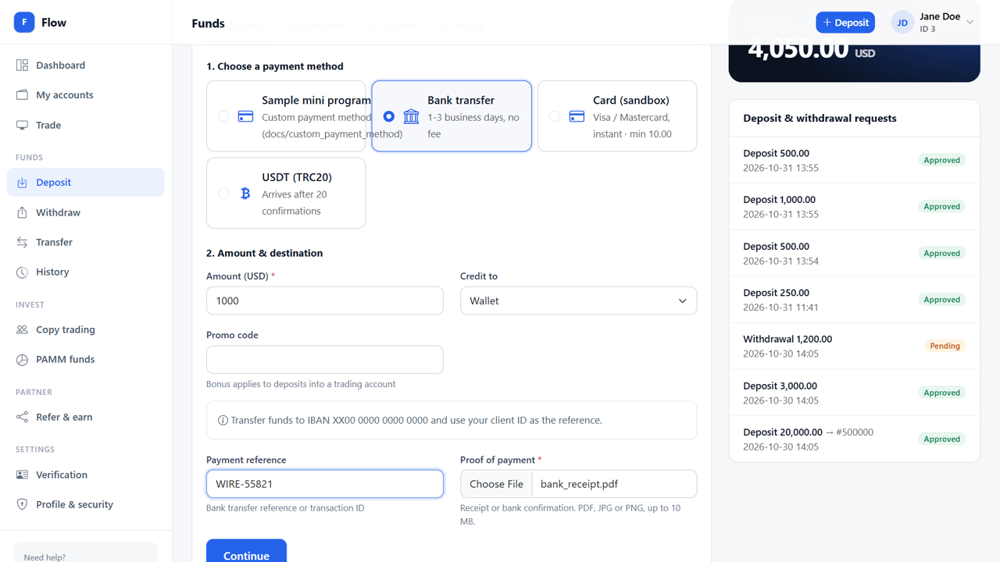
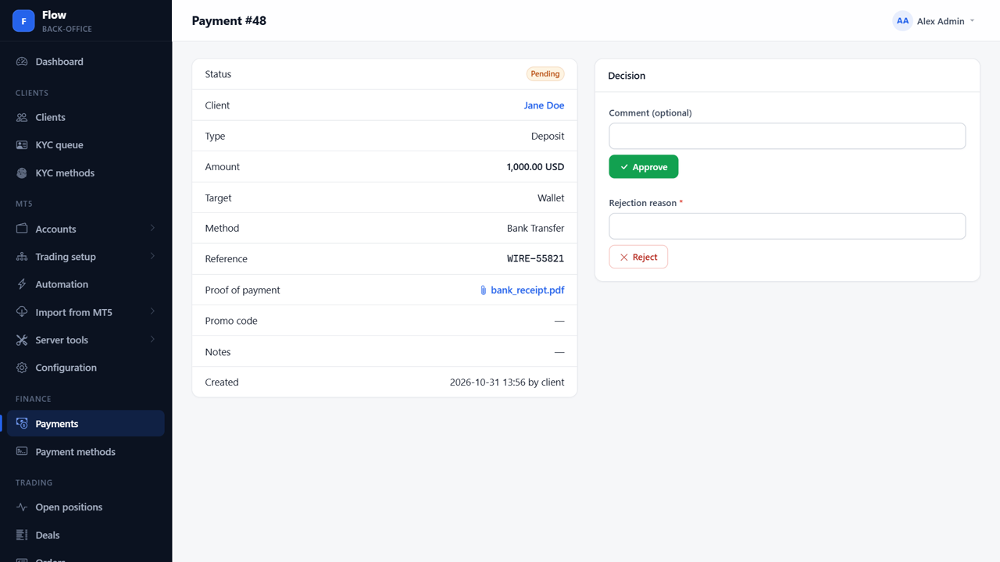
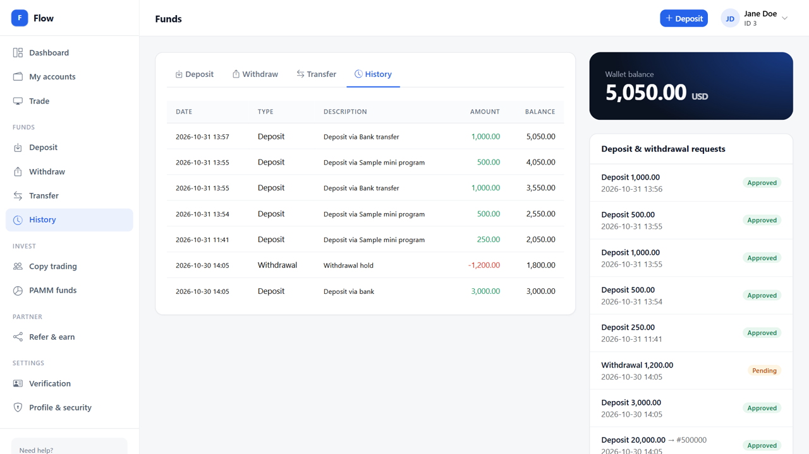
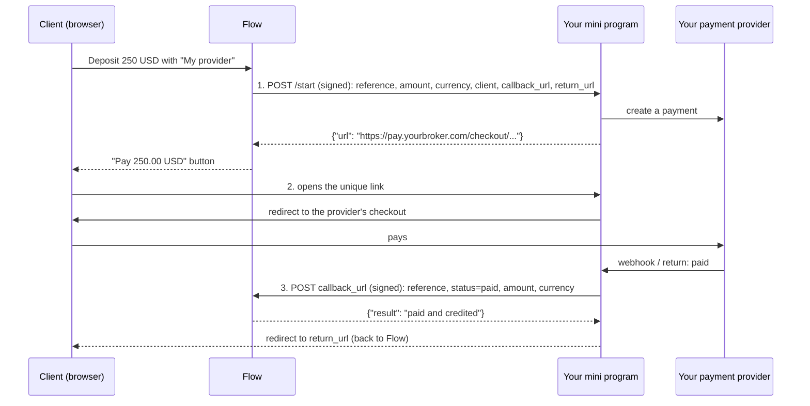
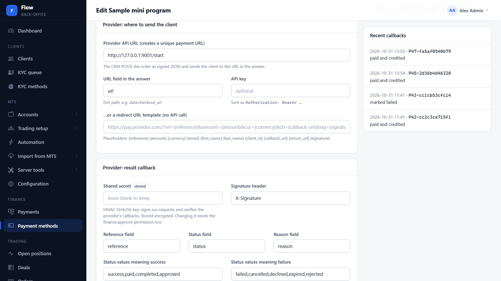
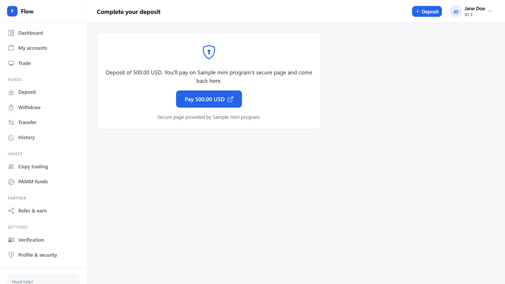
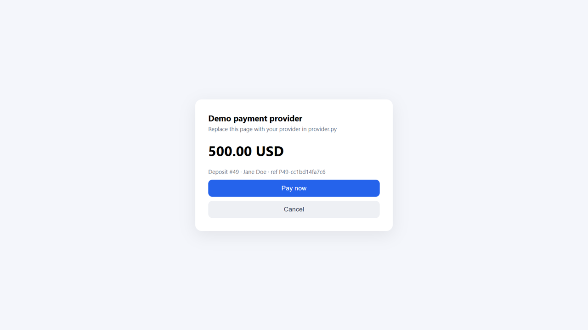
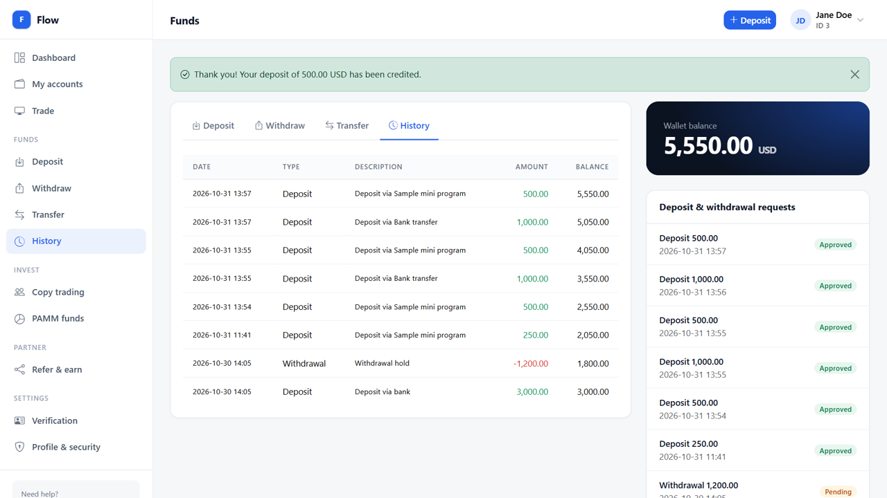

# Payment methods

Flow takes deposits (and pays withdrawals) through **payment methods**, configured under
**Finance → Payment methods**. There are two kinds:

| | Manual | Custom |
|---|---|---|
| **For** | Bank transfer, USDT, cash desk... anything your team checks by hand | Any payment provider in the world |
| **The client** | Pays outside Flow following your instructions, enters the reference, uploads a proof | Clicks *Pay* and pays on the provider's page |
| **Who confirms** | Your finance team approves it (a second person) | Your provider, through your **mini program** |
| **Credited** | When finance approves | Automatically, when the paid amount matches |
| **Code needed** | None | A small mini program: sample in [`custom/`](custom/) |

**Video (2½ minutes):** [payment-methods.mp4](payment-methods.mp4), both flows from start to finish.

This folder:

- [`manual/`](manual/): screenshots of the manual flow.
- [`custom/`](custom/): the sample mini program (`mini_program.py`, `provider.py`) and screenshots of the custom flow.

## Manual methods



1. **Set up the method.** Finance → Payment methods → New, type **Manual**: name, short description,
   instructions for the client (your bank details, the reference to use), currency, minimum / maximum,
   deposits and / or withdrawals, and whether a **proof of payment** is required.
2. **The client deposits.** In the client area they choose the method, see your instructions, enter the
   amount, where it goes (wallet or an MT5 account), the payment reference and attach the receipt. The
   request is **pending**.
3. **Finance approves.** Finance → Payments lists every pending request. Open it, check the reference and
   the proof, then **Approve** (optional comment) or **Reject** (reason required, shown to the client). The
   approver must be someone other than whoever created the request (maker-checker).
4. **Flow credits it.** Approved deposits go to the wallet or straight to the MT5 account. Withdrawals are
   approved the same way and paid out by finance (a wallet withdrawal is held from the request until the
   decision; an MT5 withdrawal is taken from the account on approval).

| 1. The method | 2. The client deposits |
|---|---|
|  |  |
| **3. Finance approves** | **4. Credited** |
|  |  |

## Custom methods

No CRM can ship every payment provider in the world. Instead, Flow lets you plug in **any** provider (card
acquirer, e-wallet, crypto gateway, local bank transfer, ...) by writing a small **mini program** that sits
between Flow and your provider. Flow never needs to know who the provider is.

The sample mini program is in [`custom/`](custom/): Python, standard library only, about 200 lines.

### How it works



1. **Flow asks your mini program for a unique link.** When a client deposits with your method, Flow sends
   a signed `POST` to the method's *Provider API URL*. Your mini program creates the payment (at your
   provider) and answers with the link.
2. **The client goes to that link.** Flow shows a *Pay 250.00 USD* button that opens it. From here your
   mini program and your provider handle everything.
3. **Your mini program reports the result.** It sends a signed `POST` to the `callback_url` it received in
   step 1, then sends the client back to the `return_url`. With *Credit automatically when paid* on, Flow
   credits the deposit right away.


| 1. The method | 2. Flow's pay button |
|---|---|
|  |  |
| **3. The mini program** | **4. Credited automatically** |
|  |  |

### Try it in 5 minutes

1. Start the Flow demo (`run-demo.ps1`), or use your own Flow.
2. Run the sample:

   ```powershell
   cd docs/payment/custom
   $env:FLOW_SECRET = "choose-a-long-random-secret"
   $env:FLOW_URL = "http://127.0.0.1:8000"
   python mini_program.py
   ```

3. In Flow's back office: **Finance → Payment methods → New**.
   - Type: **Custom**
   - Provider API URL: `http://127.0.0.1:9001/start`
   - Shared secret: the same value as `FLOW_SECRET`
   - Leave the other fields at their defaults and save.
4. Log in to the client area, deposit with the new method, click **Pay**, then **Pay now** on the demo page.
   You land back in Flow with *"Your deposit of ... has been credited"*. **Cancel** shows the failure path.

### Settings of the sample

| Variable | Meaning |
|---|---|
| `FLOW_SECRET` | The method's **Shared secret** in Flow. Required. Signs both directions. |
| `FLOW_API_KEY` | The method's **API key** in Flow, if you set one. Flow then sends `Authorization: Bearer <key>`. |
| `FLOW_URL` | Your Flow address. The mini program only accepts `callback_url`s on it. |
| `PUBLIC_URL` | The mini program's address as clients reach it, e.g. `https://pay.yourbroker.com`. |
| `PORT` | Default `9001`. |

### The contract

You can write the mini program in any language. It only has to follow these rules.

#### Signatures

Every request in both directions carries a signature header (default `X-Signature`):

```
X-Signature: hex( HMAC-SHA256( key = shared secret, message = raw request body ) )
```

Compute it over the **exact bytes** you send or receive, before any JSON parsing. A `sha256=` prefix is
accepted. Compare signatures in constant time.

```js
// Node.js
const sig = require("crypto").createHmac("sha256", secret).update(rawBody).digest("hex");
```

```php
// PHP
$sig = hash_hmac('sha256', $rawBody, $secret);
```

#### 1. Flow → mini program: create a payment

`POST <Provider API URL>`, `Content-Type: application/json`, signed. Optional `Authorization: Bearer <API key>`.

| Field | Example | Notes |
|---|---|---|
| `reference` | `P42-cc2c3ce715f1` | Flow's id for this deposit. Send it back in the callback. |
| `amount` | `"250.00"` | A string, to keep decimals exact. |
| `currency` | `USD` | |
| `description` | `Deposit #42` | |
| `client_id`, `email`, `first_name`, `last_name`, `country` | | Useful for the provider (KYC data, receipts). |
| `callback_url` | `https://portal.yourbroker.com/callbacks/payment/<token>` | Where to report the result. |
| `return_url` | `https://portal.yourbroker.com/portal/wallet/return/42` | Where to send the client afterwards. |

**Answer** within 15 seconds with HTTP 200 and JSON containing the client's link:

```json
{"url": "https://pay.yourbroker.com/checkout/20oIRngaFqbW"}
```

If the link sits elsewhere in your answer, set **URL field in the answer** to its dot path
(e.g. `data.checkout_url`). Any non-2xx answer, or no URL, shows the client *"not available right now"*.
Flow never follows redirects and, in production, only calls public `https://` addresses.

#### 2. The client

Flow shows the client a *Pay* button that opens your link. Once they've finished, send them to `return_url`.
Flow then shows the outcome: credited, failed, or *"We'll credit your deposit as soon as the payment is
confirmed"* if your callback hasn't arrived yet. Callback first, redirect second gives the best experience.

#### 3. Mini program → Flow: report the result

`POST <callback_url>`, JSON (or form-encoded), signed:

```json
{"reference": "P42-cc2c3ce715f1", "status": "paid", "amount": "250.00", "currency": "USD",
 "transaction_id": "PSP-998877", "reason": ""}
```

| Field | Meaning |
|---|---|
| `reference` | From step 1. |
| `status` | `paid` / `success` / `completed` / `approved`: paid. `failed` / `cancelled` / `declined` / `expired` / `rejected`: not paid (the deposit is closed with `reason`). Anything else, e.g. `pending`: noted, still waiting. |
| `amount` | The amount **actually paid**. Required for auto-credit. |
| `currency` | Optional. If sent, it must match. |
| `transaction_id` | Optional. The provider's id, stored on the deposit for reconciliation. |
| `reason` | Shown to the client when the payment failed. |

All field names and status values can be changed on the method in Flow (*Reference field*, *Status field*,
*Status values meaning success / failure*, *Paid amount field*), so you can even forward a provider's own
callback unchanged.

**Flow's answers:**

| HTTP | Body `result` | What to do |
|---|---|---|
| 200 | `paid and credited`, `paid, waiting for finance approval`, `marked failed`, `noted, still pending`, `already approved`, ... | Done. Repeating a callback is safe. |
| 200 | `paid amount 240.00 differs from 250.00: held for review` | Done. Finance reviews it in **Payments**. |
| 401 | `invalid signature` | Wrong secret, or the body changed after signing. |
| 404 | `unknown reference ...` / `unknown callback URL` | Wrong `reference`, or the method's callback URL was replaced. |

On a network error or a 5xx, **retry** (for example after 1, 5 and 30 minutes). Every callback, accepted or
not, is listed under **Recent callbacks** on the method's page in Flow, with its result.

#### Money safety built into Flow

- A deposit is credited **once**. Later callbacks for it are ignored.
- With auto-credit, the paid `amount` (and `currency`, if sent) must match the request **exactly**.
  Otherwise the deposit is held for finance.
- Turn auto-credit off and finance approves every paid deposit instead.
- Setting the secret or turning auto-credit on needs the `finance.approve` permission and is audited.
- Withdrawals with a custom method are paid out by your finance team, as with manual methods.

### Plug in your real provider

Only [`custom/provider.py`](custom/provider.py) changes. `mini_program.py` already handles Flow.

- `create_checkout(session, public_url)`: create the payment at your provider and return its checkout URL.
  Give the provider `session["id"]` as the order id, `{public_url}/return/{id}` as the return URL and
  `{public_url}/provider/webhook` as the notification URL.
- `parse_webhook(headers, raw)`: **verify the provider's own signature**, then return
  `(session id, status, transaction id, amount, currency, reason)`.
- Delete the demo page functions when you no longer need them.

Trust the provider's **server-to-server webhook**, never the client's browser coming back. Only the webhook
proves a payment.

### Going live

- [ ] Serve the mini program over **https** behind your reverse proxy, e.g. `https://pay.yourbroker.com`.
- [ ] Use a long random shared secret (at least 32 characters), kept out of source control.
- [ ] Set `FLOW_URL` to your real Flow address.
- [ ] Verify your provider's webhook signature in `parse_webhook`.
- [ ] Replace `sessions.json` with a database if you run more than one instance.
- [ ] Retry callbacks that fail with a network error or a 5xx.
- [ ] Do a small real deposit and a cancelled one, then check **Payments** and the method's **Recent callbacks**.
